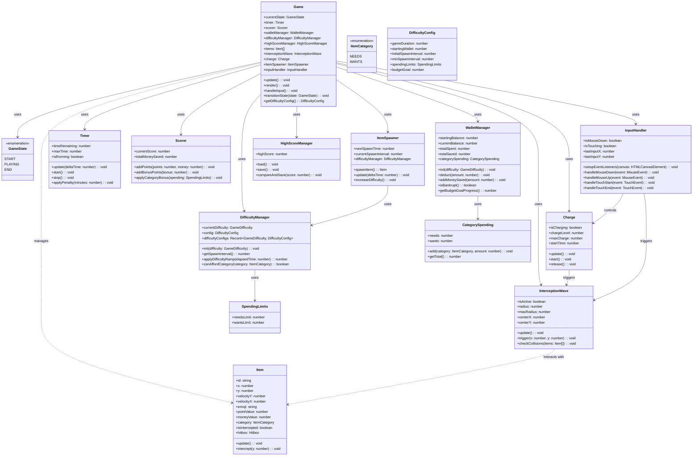

# Design Document: Hold To Resist

## Overview

"Hold To Resist" (按住别买) is a web-based arcade mini-game where players intercept falling temptation items before they enter a shopping cart zone. Players hold input to charge power, then release to fire an interception wave that bounces items back up for points. The game features a 30-second timer, scoring system tracking intercepted items and money "saved," a Wallet system where money is deducted when items reach the shopping cart, and progressive difficulty with three difficulty tiers.

**Key Mechanics:**
- Charge & Release input system (hold to charge, release to fire wave)
- Gravity-based falling items with interception mechanics
- Wallet system with starting balance and money deduction
- Progressive difficulty scaling (items spawn faster as time decreases)
- Category-based spending limits (MEDIUM/HARD difficulty)
- Budget goal tracking (HARD difficulty)
- Responsive design for mobile and desktop
- Persistent high score tracking via localStorage

**Difficulty Tiers:**
- **EASY (MVP):** Simple charge & release, $100 starting wallet, 30-second timer
- **MEDIUM:** Needs/Wants categories, $150 starting wallet, category spending limits
- **HARD:** Budget goal ($150 saved), $200 starting wallet, time penalties for failed intercepts

**Technical Constraints:**
- Single HTML file (HTML + CSS + JS merged)
- Zero external dependencies (HTML5, CSS3, Vanilla JavaScript only)
- Emoji-based visual assets
- 60 FPS rendering target
- Touch and mouse input support

## Architecture

### Entity Relationships



### System Components

```
┌─────────────────────────────────────────────────────────────────┐
│                        Game Engine                              │
│  ┌──────────────────────────────────────────────────────────┐  │
│  │                   State Machine                          │  │
│  │   START → PLAYING → END (transitions based on timer/    │  │
│  │   wallet/difficulty/score)                               │  │
│  └──────────────────────────────────────────────────────────┘  │
│                         │                                       │
│  ┌──────────────────────┴───────────────────────────────────┐  │
│  │                    Game Loop                             │  │
│  │   ┌───────────────┐  ┌───────────────┐  ┌──────────────┐ │  │
│  │   │  Input Handle │  │  Update Logic │  │  Render      │ │  │
│  │   │  (15ms)       │  │  (15ms)       │  │  (20ms)      │ │  │
│  │   └───────────────┘  └───────────────┘  └──────────────┘ │  │
│  └──────────────────────────────────────────────────────────┘  │
│                         │                                       │
│  ┌──────────────────────┴───────────────────────────────────┐  │
│  │                   Core Systems                           │  │
│  │   ┌──────────┐ ┌──────────┐ ┌──────────┐ ┌──────────┐   │  │
│  │   │  Item    │ │  Charge  │ │Wave      │ │  Timer   │   │  │
│  │   │  Spawner │ │          │ │Intercept │ │          │   │  │
│  │   └──────────┘ └──────────┘ └──────────┘ └──────────┘   │  │
│  │   ┌──────────┐ ┌──────────┐ ┌──────────┐                 │  │
│  │   │Wallet    │ │Difficulty│ │ Scorer   │                 │  │
│  │   │Manager   │ │Manager   │ │          │                 │  │
│  │   └──────────┘ └──────────┘ └──────────┘                 │  │
│  └──────────────────────────────────────────────────────────┘  │
│                         │                                       │
│  ┌──────────────────────┴───────────────────────────────────┐  │
│  │                  Rendering & UI                          │  │
│  │   Canvas (items, wave, charge) + DOM UI (HUD, screens)   │  │
│  └──────────────────────────────────────────────────────────┘  │
└─────────────────────────────────────────────────────────────────┘
```

## Components and Interfaces

### Game Core

```typescript
interface GameDifficulty {
  EASY: 'EASY';
  MEDIUM: 'MEDIUM';
  HARD: 'HARD';
}

interface GameState {
  START: 'START';
  PLAYING: 'PLAYING';
  END: 'END';
}

interface GameConfig {
  canvasWidth: number;
  canvasHeight: number;
  gravity: number;
  terminalVelocity: number;
  maxHealth: number;
  basePoints: number;
  maxBonusPoints: number;
}

interface Game {
  state: GameState;
  config: GameConfig;
  items: Item[];
  interceptionWave: InterceptionWave | null;
  charge: Charge;
  timer: Timer;
  scorer: Scorer;
  walletManager: WalletManager;
  difficultyManager: DifficultyManager;
  highScoreManager: HighScoreManager;
  itemSpawner: ItemSpawner;
  inputHandler: InputHandler;
  
  update(deltaTime: number): void;
  render(): void;
  transitionState(newState: GameState): void;
  endGame(): void;
  getDifficultyConfig(): DifficultyConfig;
}
```

### Item System

```typescript
interface ItemCategory {
  NEEDS: 'NEEDS';
  WANTS: 'WANTS';
}

interface Item {
  id: string;
  x: number;
  y: number;
  velocityY: number;
  velocityX: number;
  emoji: string;
  pointValue: number;
  moneyValue: number;
  category: ItemCategory;
  radius: number;
  hitbox: {
    left: number;
    right: number;
    top: number;
    bottom: number;
  };
  isIntercepted: boolean;
  originalY: number;
}

interface ItemSpawner {
  nextSpawnTime: number;
  currentSpawnInterval: number;
  difficultyManager: DifficultyManager;
  
  update(deltaTime: number): void;
  spawnItem(): Item;
  increaseDifficulty(): void;
}

interface TemptationItem {
  emoji: string;
  pointValue: number;
  moneyValue: number;
  category: ItemCategory;
  radius: number;
  gravityMultiplier: number;
}

// Predefined temptation items with categories (MEDIUM/HARD difficulty)
// EASY difficulty: all items have no category
const temptationItems: TemptationItem[] = [
  { emoji: '🧋', pointValue: 10, moneyValue: 5, category: 'NEEDS', radius: 20, gravityMultiplier: 1.0 },
  { emoji: '🏷️', pointValue: 15, moneyValue: 10, category: 'NEEDS', radius: 18, gravityMultiplier: 1.2 },
  { emoji: '🔗', pointValue: 20, moneyValue: 15, category: 'NEEDS', radius: 16, gravityMultiplier: 1.4 },
  { emoji: '🛍️', pointValue: 25, moneyValue: 20, category: 'WANTS', radius: 22, gravityMultiplier: 0.9 },
  { emoji: '💎', pointValue: 35, moneyValue: 50, category: 'WANTS', radius: 14, gravityMultiplier: 1.6 },
  { emoji: '📱', pointValue: 30, moneyValue: 35, category: 'WANTS', radius: 18, gravityMultiplier: 1.3 },
  { emoji: '👗', pointValue: 25, moneyValue: 25, category: 'WANTS', radius: 18, gravityMultiplier: 1.1 },
  { emoji: '🎮', pointValue: 30, moneyValue: 40, category: 'WANTS', radius: 20, gravityMultiplier: 1.2 },
];
```

### Difficulty Manager

```typescript
interface DifficultyManager {
  currentDifficulty: GameDifficulty;
  config: DifficultyConfig;
  difficultyConfigs: Record<GameDifficulty, DifficultyConfig>;
  
  init(difficulty: GameDifficulty): void;
  getSpawnInterval(): number;
  applyDifficultyRamp(elapsedTime: number): number;
  canAffordCategory(category: ItemCategory): boolean;
  getBudgetGoalProgress(): number;
}

interface DifficultyConfig {
  gameDuration: number;
  startingWallet: number;
  initialSpawnInterval: number;
  minSpawnInterval: number;
  spendingLimits: SpendingLimits;
  budgetGoal: number;
}

interface SpendingLimits {
  needsLimit: number;
  wantsLimit: number;
}

// Difficulty tier configurations
const difficultyConfigs: Record<GameDifficulty, DifficultyConfig> = {
  EASY: {
    gameDuration: 30,           // 30 seconds
    startingWallet: 100,        // $100
    initialSpawnInterval: 2000, // 2 seconds
    minSpawnInterval: 500,      // 0.5 seconds
    spendingLimits: {
      needsLimit: 0,            // No limits in EASY
      wantsLimit: 0,
    },
    budgetGoal: 0,              // No goal in EASY
  },
  MEDIUM: {
    gameDuration: 30,           // 30 seconds
    startingWallet: 150,        // $150
    initialSpawnInterval: 2000, // 2 seconds
    minSpawnInterval: 500,      // 0.5 seconds
    spendingLimits: {
      needsLimit: 80,           // $80 limit
      wantsLimit: 120,          // $120 limit
    },
    budgetGoal: 0,              // No goal in MEDIUM
  },
  HARD: {
    gameDuration: 45,           // 45 seconds
    startingWallet: 200,        // $200
    initialSpawnInterval: 2000, // 2 seconds
    minSpawnInterval: 300,      // 0.3 seconds (faster ramp)
    spendingLimits: {
      needsLimit: 100,          // $100 limit
      wantsLimit: 150,          // $150 limit
    },
    budgetGoal: 150,            // Save $150
  },
};
```

### Input and Charge System

```typescript
interface Charge {
  isCharging: boolean;
  chargeLevel: number;  // 0.0 to 1.0
  maxCharge: number;
  chargeRate: number;   // charge per millisecond
  startTime: number | null;
  
  start(): void;
  release(): number;  // returns charge level (0.0 to 1.0)
  update(): void;
  reset(): void;
}

interface InputHandler {
  isMouseDown: boolean;
  isTouching: boolean;
  lastInputX: number;
  lastInputY: number;
  
  setupEventListeners(canvas: HTMLCanvasElement): void;
  handleMouseDown(event: MouseEvent): void;
  handleMouseUp(event: MouseEvent): void;
  handleTouchStart(event: TouchEvent): void;
  handleTouchEnd(event: TouchEvent): void;
  getInterceptionCenter(): { x: number; y: number };
}
```

### Interception Wave System

```typescript
interface InterceptionWave {
  isActive: boolean;
  centerX: number;
  centerY: number;
  radius: number;
  maxRadius: number;
  expansionSpeed: number;
  duration: number;
  timeActive: number;
  
  trigger(x: number, y: number, chargeLevel: number): void;
  update(deltaTime: number): void;
  checkCollisions(items: Item[]): Item[];
  draw(ctx: CanvasRenderingContext2D): void;
  isFinished(): boolean;
}

interface WaveEffect {
  opacity: number;
  lineWidth: number;
  color: string;
}

// Visual properties for the interception wave
const waveProperties: WaveEffect = {
  opacity: 1.0,
  lineWidth: 3,
  color: '#00ffcc',
};
```

### Scoring and Wallet

```typescript
interface Scorer {
  currentScore: number;
  totalMoneySaved: number;
  
  addPoints(points: number, money: number): void;
  addBonusPoints(bonus: number): void;
  applyCategoryBonus(spending: SpendingLimits): void;
  reset(): void;
}

interface WalletManager {
  startingBalance: number;
  currentBalance: number;
  totalSpent: number;
  totalSaved: number;
  categorySpending: CategorySpending;
  
  init(difficulty: GameDifficulty): void;
  deduct(amount: number): void;
  addMoneySaved(amount: number): void;
  isBankrupt(): boolean;
  getBudgetGoalProgress(): number;
}

interface CategorySpending {
  needs: number;
  wants: number;
  add(category: ItemCategory, amount: number): void;
  getTotal(): number;
}

interface Timer {
  timeRemaining: number;
  maxTime: number;
  isRunning: boolean;
  
  update(deltaTime: number): void;
  start(): void;
  stop(): void;
  reset(): void;
  applyPenalty(minutes: number): void;
}
```

### High Score Management

```typescript
interface HighScoreManager {
  localStorageKey: string;
  highScore: number;
  
  load(): void;
  save(): void;
  compareAndSave(score: number): boolean;
  reset(): void;
}
```

### Language/Internationalization System (i18n)

```typescript
type Language = 'en' | 'zh-CN' | 'zh-TW';

interface I18nManager {
  currentLanguage: Language;
  translations: Record<Language, TranslationStrings>;
  
  init(): void;
  setLanguage(lang: Language): void;
  t(key: string): string;
  getCurrentLanguage(): Language;
}

interface TranslationStrings {
  // Game Title
  gameTitle: string;
  
  // Start Screen
  startGame: string;
  selectDifficulty: string;
  highScore: string;
  
  // Difficulty Labels
  easy: string;
  medium: string;
  hard: string;
  
  // HUD
  score: string;
  wallet: string;
  time: string;
  moneySaved: string;
  spent: string;
  needs: string;
  wants: string;
  
  // End Screen
  gameOver: string;
  finalScore: string;
  totalSaved: string;
  totalSpent: string;
  playAgain: string;
  
  // Instructions
  holdToCharge: string;
  releaseToFire: string;
  
  // Budget Progress (HARD)
  budgetGoal: string;
  budgetProgress: string;
}

// Translation strings for all supported languages
const translations: Record<Language, TranslationStrings> = {
  en: {
    gameTitle: 'Hold To Resist',
    startGame: 'START GAME',
    selectDifficulty: 'SELECT DIFFICULTY',
    highScore: 'HIGH SCORE',
    easy: 'EASY',
    medium: 'MEDIUM',
    hard: 'HARD',
    score: 'SCORE',
    wallet: 'WALLET',
    time: 'TIME',
    moneySaved: 'SAVED',
    spent: 'SPENT',
    needs: 'NEEDS',
    wants: 'WANTS',
    gameOver: 'GAME OVER',
    finalScore: 'FINAL SCORE',
    totalSaved: 'MONEY SAVED',
    totalSpent: 'MONEY SPENT',
    playAgain: 'PLAY AGAIN',
    holdToCharge: 'HOLD TO CHARGE',
    releaseToFire: 'RELEASE TO FIRE',
    budgetGoal: 'BUDGET GOAL',
    budgetProgress: 'GOAL PROGRESS',
  },
  'zh-CN': {
    gameTitle: '按住别买',
    startGame: '开始游戏',
    selectDifficulty: '选择难度',
    highScore: '最高分',
    easy: '简单',
    medium: '中等',
    hard: '困难',
    score: '分数',
    wallet: '钱包',
    time: '时间',
    moneySaved: '已省',
    spent: '已花',
    needs: '需要',
    wants: '想要',
    gameOver: '游戏结束',
    finalScore: '最终分数',
    totalSaved: '省钱总额',
    totalSpent: '花钱总额',
    playAgain: '再玩一次',
    holdToCharge: '按住蓄力',
    releaseToFire: '松开发射',
    budgetGoal: '预算目标',
    budgetProgress: '目标进度',
  },
  'zh-TW': {
    gameTitle: '按住別買',
    startGame: '開始遊戲',
    selectDifficulty: '選擇難度',
    highScore: '最高分',
    easy: '簡單',
    medium: '中等',
    hard: '困難',
    score: '分數',
    wallet: '錢包',
    time: '時間',
    moneySaved: '已省',
    spent: '已花',
    needs: '需要',
    wants: '想要',
    gameOver: '遊戲結束',
    finalScore: '最終分數',
    totalSaved: '省錢總額',
    totalSpent: '花錢總額',
    playAgain: '再玩一次',
    holdToCharge: '按住儲力',
    releaseToFire: '放開發射',
    budgetGoal: '預算目標',
    budgetProgress: '目標進度',
  },
};

// I18n Manager implementation
class I18nManager implements II18nManager {
  currentLanguage: Language = 'en';
  translations = translations;
  
  init(): void {
    const saved = localStorage.getItem('language');
    if (saved && (saved === 'en' || saved === 'zh-CN' || saved === 'zh-TW')) {
      this.currentLanguage = saved;
    }
  }
  
  setLanguage(lang: Language): void {
    this.currentLanguage = lang;
    localStorage.setItem('language', lang);
  }
  
  t(key: string): string {
    return this.translations[this.currentLanguage][key as keyof TranslationStrings] || key;
  }
  
  getCurrentLanguage(): Language {
    return this.currentLanguage;
  }
}
```

### Difficulty Manager

```typescript
interface DifficultyManager {
  currentDifficulty: GameDifficulty;
  config: DifficultyConfig;
  difficultyConfigs: Record<GameDifficulty, DifficultyConfig>;
  
  init(difficulty: GameDifficulty): void;
  getSpawnInterval(): number;
  applyDifficultyRamp(elapsedTime: number): number;
  canAffordCategory(category: ItemCategory): boolean;
  getBudgetGoalProgress(): number;
}

interface DifficultyConfig {
  gameDuration: number;
  startingWallet: number;
  initialSpawnInterval: number;
  minSpawnInterval: number;
  spendingLimits: SpendingLimits;
  budgetGoal: number;
}

interface SpendingLimits {
  needsLimit: number;
  wantsLimit: number;
}

// Difficulty tier configurations
const difficultyConfigs: Record<GameDifficulty, DifficultyConfig> = {
  EASY: {
    gameDuration: 30,           // 30 seconds
    startingWallet: 100,        // $100
    initialSpawnInterval: 2000, // 2 seconds
    minSpawnInterval: 500,      // 0.5 seconds
    spendingLimits: {
      needsLimit: 0,            // No limits in EASY
      wantsLimit: 0,
    },
    budgetGoal: 0,              // No goal in EASY
  },
  MEDIUM: {
    gameDuration: 30,           // 30 seconds
    startingWallet: 150,        // $150
    initialSpawnInterval: 2000, // 2 seconds
    minSpawnInterval: 500,      // 0.5 seconds
    spendingLimits: {
      needsLimit: 80,           // $80 limit
      wantsLimit: 120,          // $120 limit
    },
    budgetGoal: 0,              // No goal in MEDIUM
  },
  HARD: {
    gameDuration: 45,           // 45 seconds
    startingWallet: 200,        // $200
    initialSpawnInterval: 2000, // 2 seconds
    minSpawnInterval: 300,      // 0.3 seconds (faster ramp)
    spendingLimits: {
      needsLimit: 100,          // $100 limit
      wantsLimit: 150,          // $150 limit
    },
    budgetGoal: 150,            // Save $150
  },
};
```

## Data Models

### Game State

```typescript
interface GameState {
  start: 'START';
  playing: 'PLAYING';
  end: 'END';
}
```

### Game Save Data

```typescript
interface GameSaveData {
  highScore: number;
  totalGamesPlayed: number;
  totalItemsIntercepted: number;
  lastPlayed: number;
}
```

### Input Event Types

```typescript
interface InputEvent {
  type: 'mousedown' | 'mouseup' | 'touchstart' | 'touchend';
  x: number;
  y: number;
  timestamp: number;
}
```

### Collision Detection

```typescript
interface Hitbox {
  left: number;
  right: number;
  top: number;
  bottom: number;
  centerX: number;
  centerY: number;
  width: number;
  height: number;
}

interface CollisionResult {
  collided: boolean;
  item: Item | null;
  wave: InterceptionWave | null;
  overlapX: number;
  overlapY: number;
  distance: number;
}
```

## Core Mechanics Design

### 1. Charge & Release Mechanic

**Charge Phase:**
- Player presses down (mouse or touch) → charge starts
- Charge level increases linearly at `chargeRate` (e.g., 0.5% per ms)
- Charge bar visually grows from 0% to 100%
- Charge rate is constant regardless of device (time-based, not frame-based)

**Release Phase:**
- Player releases input → charge level is captured
- Interception wave triggers at charge position
- Wave radius expands based on charge level:
  - 0-20%: No wave (weak charge)
  - 21-50%: Small wave (radius 100px)
  - 51-80%: Medium wave (radius 150px)
  - 81-100%: Large wave (radius 200px)

**Charge Algorithm:**

```javascript
function startCharge() {
  if (charge.isCharging) return;
  charge.isCharging = true;
  charge.startTime = performance.now();
}

function updateCharge() {
  if (!charge.isCharging) return;
  const currentTime = performance.now();
  const elapsed = currentTime - (charge.startTime || currentTime);
  charge.chargeLevel = Math.min(elapsed * charge.chargeRate, 1.0);
}

function releaseCharge() {
  if (!charge.isCharging) return 0;
  charge.isCharging = false;
  const finalCharge = charge.chargeLevel;
  
  if (finalCharge > 0.2) {
    triggerInterceptionWave(finalCharge);
  }
  
  charge.reset();
  return finalCharge;
}
```

### 2. Falling Temptation Items

**Spawn Algorithm:**
- Initial spawn rate: 2000ms between items
- Spawn interval decreases by 50ms every 5 seconds
- Minimum interval: 500ms
- Items spawn at random X positions (20% to 80% of screen width)

**Item Physics:**
- Vertical velocity increases by gravity each frame
- Terminal velocity caps maximum fall speed
- Items fall straight down unless intercepted

**Spawn Code:**

```javascript
function spawnItem(): Item {
  const randomIndex = Math.floor(Math.random() * temptationItems.length);
  const template = temptationItems[randomIndex];
  
  const screenPadding = canvasWidth * 0.2;
  const randomX = screenPadding + Math.random() * (canvasWidth - screenPadding * 2);
  
  return {
    id: generateUUID(),
    x: randomX,
    y: -template.radius,
    velocityY: 0,
    velocityX: 0,
    emoji: template.emoji,
    pointValue: template.pointValue,
    moneyValue: template.moneyValue,
    radius: template.radius,
    hitbox: createHitbox(randomX, -template.radius, template.radius),
    isIntercepted: false,
    originalY: -template.radius,
  };
}

function updateItemPhysics(item: Item, deltaTime: number) {
  // Apply gravity
  item.velocityY += gravity * deltaTime;
  
  // Cap at terminal velocity
  item.velocityY = Math.min(item.velocityY, terminalVelocity);
  
  // Update position
  item.y += item.velocityY * deltaTime;
  
  // Update hitbox
  item.hitbox = createHitbox(item.x, item.y, item.radius);
}
```

### 3. Interception Wave Mechanics

**Wave Behavior:**
- Wave radius expands from 0 to max based on charge level
- Wave duration: 500ms
- Wave expands at constant speed
- Wave color fades from bright cyan to transparent

**Collision Detection:**
- Circle-to-circle collision between wave and items
- Item must be within vertical range of wave center ± wave radius

**Interception Logic:**

```javascript
function checkInterception(wave: InterceptionWave, items: Item[]): Item[] {
  const interceptedItems: Item[] = [];
  
  for (const item of items) {
    if (item.isIntercepted) continue;
    
    const distance = Math.hypot(wave.centerX - item.x, wave.centerY - item.y);
    const combinedRadius = wave.radius + item.radius;
    
    if (distance <= combinedRadius) {
      item.isIntercepted = true;
      
      // Calculate bonus based on distance from wave center
      const distanceRatio = distance / combinedRadius;
      const bonus = Math.floor(maxBonusPoints * (1 - distanceRatio));
      
      // Bounce upward with velocity based on charge
      item.velocityY = -charge.maxVelocity * wave.chargeLevel;
      item.velocityX = (item.x - wave.centerX) * 0.1; // Slight horizontal spread
      
      interceptedItems.push(item);
    }
  }
  
  return interceptedItems;
}
```

### 4. Scoring System

**Base Scoring:**
- Each intercepted item: 10 points
- Bonus points based on interception quality (up to 5 points)
- Money saved: item's moneyValue

**Bonus Calculation:**
- Perfect center interception (distance = 0): full bonus (5 points)
- Edge interception (distance = max): no bonus (0 points)
- Linear interpolation between extremes

**Scoring Code:**

```javascript
function calculateScore(item: Item, distanceFromCenter: number, maxDistance: number): { points: number; money: number } {
  const distanceRatio = distanceFromCenter / maxDistance;
  const bonusPoints = Math.floor(maxBonusPoints * (1 - distanceRatio));
  const totalPoints = basePoints + bonusPoints;
  
  return {
    points: totalPoints,
    money: item.moneyValue,
  };
}
```

### 5. Wallet System

**Wallet Deduction:**
- Item reaches bottom of screen → wallet balance decreases by item's moneyValue
- totalSpent tracking increases
- Game ends when wallet reaches $0 (bankrupt)
- No invulnerability period (money can be deducted rapidly)
- Visual feedback when wallet is low (less than $20)

**Wallet Code:**

```javascript
function deductFromWallet(amount: number) {
  walletManager.currentBalance -= amount;
  walletManager.totalSpent += amount;
  
  // Flash screen red if wallet is low
  if (walletManager.currentBalance < 20) {
    triggerLowWalletEffect();
  }
  
  // Check for bankruptcy
  if (walletManager.currentBalance <= 0) {
    walletManager.currentBalance = 0;
    endGame();
  }
}

function addMoneySaved(amount: number) {
  walletManager.totalSaved += amount;
}
```

### 6. Timer System

**Timer Behavior:**
- Starts at 30 seconds
- Decrements by 1 second per second
- Game ends when timer reaches 0
- Difficulty increases as timer decreases

**Timer Code:**

```javascript
function updateTimer(deltaTime: number) {
  timer.timeRemaining -= deltaTime;
  
  if (timer.timeRemaining <= 0) {
    timer.timeRemaining = 0;
    timer.stop();
    transitionState(GameState.END);
  }
}

function calculateSpawnInterval(): number {
  const timeElapsed = timer.maxTime - timer.timeRemaining;
  const difficultyProgress = timeElapsed / timer.maxTime;  // 0.0 to 1.0
  
  // Linear interpolation between initial and min intervals
  return initialSpawnInterval - (initialSpawnInterval - minSpawnInterval) * difficultyProgress;
}
```

### 7. Difficulty Manager

**Difficulty Tier Configuration:**
- **EASY (MVP):** 30-second timer, $100 starting wallet, no category limits
- **MEDIUM:** 30-second timer, $150 starting wallet, category spending limits (Needs: $80, Wants: $120)
- **HARD:** 45-second timer, $200 starting wallet, budget goal ($150 savings), faster difficulty ramp

**Difficulty Manager Features:**
- Configures game settings based on selected difficulty tier
- Manages spawn intervals with difficulty ramp
- Enforces category spending limits in MEDIUM and HARD
- Tracks budget goal progress in HARD mode
- Applies time penalties for failed intercepts in HARD mode

**Difficulty Algorithm:**

```
Spawn Interval = Initial - (Initial - Min) × (Time Elapsed / Total Time)

Example (EASY):
- Initial: 2000ms, Min: 500ms
- At 0s elapsed: 2000ms
- At 15s elapsed: 1250ms
- At 30s elapsed: 500ms

Example (HARD - faster ramp):
- Initial: 2000ms, Min: 300ms
- At 0s elapsed: 2000ms
- At 22.5s elapsed: 1150ms
- At 45s elapsed: 300ms
```

### 8. Game Timer

**Timer Management:**
- 30-second countdown
- Displays as "00:XX" format
- Visual warning when below 5 seconds (color change)
- Final 3 seconds: rapid blinking effect

## Game Loop Design

### Main Loop Structure

```javascript
// Game loop using requestAnimationFrame for 60 FPS
let lastTime = 0;
let accumulator = 0;
const fixedTimeStep = 1000 / 60;  // 60 FPS

function gameLoop(currentTime: number) {
  const deltaTime = currentTime - lastTime;
  lastTime = currentTime;
  
  // Update charge
  charge.update();
  
  // Update timer
  timer.update(deltaTime);
  
  // Update items
  updateItems(deltaTime);
  
  // Update interception wave
  if (interceptionWave) {
    interceptionWave.update(deltaTime);
    checkInterceptions();
  }
  
  // Spawn items
  itemSpawner.update(deltaTime);
  
  // Check game end conditions
  checkGameEndConditions();
  
  // Render
  render();
  
  // Continue loop
  requestAnimationFrame(gameLoop);
}
```

### Update vs Render Separation

- **Update phase**: Logic calculations (position, physics, collisions, state)
- **Render phase**: Drawing to canvas (items, wave, charge, UI overlays)
- This separation allows consistent physics regardless of frame rate

### Performance Optimization

1. **Object Pooling**: Reuse item objects instead of creating/destroying
2. **Efficient Collision Detection**: Only check items within wave radius range
3. **Canvas Optimization**: Use single canvas context, minimize state changes
4. **Memory Management**: Clear references to removed items for garbage collection
5. **Frame Rate Target**: 60 FPS (16.67ms per frame)

## Input Handling Strategy

### Mouse Input

```javascript
canvas.addEventListener('mousedown', (event) => {
  inputHandler.handleMouseDown(event);
});

canvas.addEventListener('mouseup', (event) => {
  inputHandler.handleMouseUp(event);
});
```

### Touch Input

```javascript
canvas.addEventListener('touchstart', (event) => {
  event.preventDefault();  // Prevent scrolling
  inputHandler.handleTouchStart(event);
});

canvas.addEventListener('touchend', (event) => {
  event.preventDefault();
  inputHandler.handleTouchEnd(event);
});
```

### Input Handling Implementation

```javascript
class InputHandler {
  constructor() {
    this.isMouseDown = false;
    this.isTouching = false;
    this.lastInputX = 0;
    this.lastInputY = 0;
  }
  
  setupEventListeners(canvas) {
    // Mouse events
    canvas.addEventListener('mousedown', (e) => this.handleMouseDown(e));
    canvas.addEventListener('mouseup', (e) => this.handleMouseUp(e));
    
    // Touch events
    canvas.addEventListener('touchstart', (e) => this.handleTouchStart(e), { passive: false });
    canvas.addEventListener('touchend', (e) => this.handleTouchEnd(e), { passive: false });
    
    // Prevent default on canvas to stop text selection, etc.
    canvas.addEventListener('contextmenu', (e) => e.preventDefault());
  }
  
  handleMouseDown(event) {
    this.isMouseDown = true;
    this.updateInputPosition(event.clientX, event.clientY);
    charge.start();
  }
  
  handleMouseUp(event) {
    this.isMouseDown = false;
    const chargeLevel = charge.release();
    if (chargeLevel > 0.2) {
      triggerInterceptionWave(chargeLevel);
    }
  }
  
  handleTouchStart(event) {
    event.preventDefault();
    this.isTouching = true;
    const touch = event.touches[0];
    this.updateInputPosition(touch.clientX, touch.clientY);
    charge.start();
  }
  
  handleTouchEnd(event) {
    event.preventDefault();
    this.isTouching = false;
    const chargeLevel = charge.release();
    if (chargeLevel > 0.2) {
      triggerInterceptionWave(chargeLevel);
    }
  }
  
  updateInputPosition(x, y) {
    const rect = canvas.getBoundingClientRect();
    this.lastInputX = x - rect.left;
    this.lastInputY = y - rect.top;
  }
}
```

## Physics Implementation

### Gravity System

```javascript
const GRAVITY = 0.005;  // pixels per millisecond squared
const TERMINAL_VELOCITY = 15;  // pixels per millisecond

function applyGravity(item, deltaTime) {
  item.velocityY += GRAVITY * deltaTime;
  item.velocityY = Math.min(item.velocityY, TERMINAL_VELOCITY);
}
```

### Bounce Physics

```javascript
const BOUNCE_FACTOR = 0.8;  // Items retain 80% of vertical velocity when bouncing

function bounceItem(item, chargeLevel) {
  // Initial upward velocity based on charge
  const initialVelocity = -30 * chargeLevel;
  item.velocityY = initialVelocity;
  item.velocityX = (item.x - wave.centerX) * 0.15;
  
  // Apply slight horizontal damping
  item.velocityX *= 0.9;
}
```

### Collision Detection

```javascript
function checkCircleCollision(x1, y1, r1, x2, y2, r2) {
  const dx = x1 - x2;
  const dy = y1 - y2;
  const distance = Math.sqrt(dx * dx + dy * dy);
  return distance <= r1 + r2;
}

function getCollisionNormal(x1, y1, r1, x2, y2, r2) {
  const dx = x2 - x1;
  const dy = y2 - y1;
  const distance = Math.sqrt(dx * dx + dy * dy);
  
  if (distance === 0) return { x: 0, y: -1 };  // Avoid division by zero
  
  return {
    x: dx / distance,
    y: dy / distance,
  };
}
```

## Animation System

### CSS Animations

```css
/* Charge bar growth */
.charge-bar {
  transition: width 0.1s linear;
}

/* Interception wave expansion */
.wave-effect {
  animation: waveExpansion 0.5s ease-out forwards;
}

@keyframes waveExpansion {
  0% {
    transform: scale(0);
    opacity: 0.8;
  }
  50% {
    opacity: 1;
  }
  100% {
    transform: scale(2);
    opacity: 0;
  }
}

/* Item bounce animation */
.bounce-item {
  animation: itemBounce 0.4s cubic-bezier(0.68, -0.55, 0.27, 1.55) forwards;
}

@keyframes itemBounce {
  0% {
    transform: translateY(0);
  }
  50% {
    transform: translateY(-100px);
  }
  100% {
    transform: translateY(0);
  }
}

/* Damage flash */
.damage-flash {
  animation: flashRed 0.2s ease-out forwards;
}

@keyframes flashRed {
  0% {
    background-color: rgba(255, 0, 0, 0.5);
  }
  100% {
    background-color: rgba(255, 0, 0, 0);
  }
}
```

### Canvas Drawing

```javascript
function drawItem(ctx, item) {
  ctx.font = `${item.radius * 2}px Arial`;
  ctx.textAlign = 'center';
  ctx.textBaseline = 'middle';
  ctx.fillText(item.emoji, item.x, item.y);
}

function drawInterceptionWave(ctx, wave) {
  ctx.beginPath();
  ctx.arc(wave.centerX, wave.centerY, wave.radius, 0, Math.PI * 2);
  ctx.strokeStyle = `rgba(0, 255, 204, ${wave.opacity})`;
  ctx.lineWidth = wave.lineWidth;
  ctx.stroke();
}

function drawChargeBar(ctx, charge) {
  const barWidth = 200;
  const barHeight = 20;
  const x = (canvasWidth - barWidth) / 2;
  const y = canvasHeight - 50;
  
  // Background
  ctx.fillStyle = 'rgba(0, 0, 0, 0.5)';
  ctx.fillRect(x, y, barWidth, barHeight);
  
  // Fill
  const fillWidth = barWidth * charge.chargeLevel;
  ctx.fillStyle = `hsl(${charge.chargeLevel * 120}, 100%, 50%)`;  // Green to red gradient
  ctx.fillRect(x, y, fillWidth, barHeight);
  
  // Border
  ctx.strokeStyle = '#ffffff';
  ctx.lineWidth = 2;
  ctx.strokeRect(x, y, barWidth, barHeight);
}
```

## Responsive Layout

### Mobile Detection

```javascript
function isMobile() {
  return window.innerWidth < 600;
}

function getCanvasDimensions() {
  const padding = 20;
  const width = window.innerWidth - padding * 2;
  const height = window.innerHeight - padding * 2;
  
  return {
    width: Math.min(width, 800),  // Cap max width
    height: Math.min(height, 600),
  };
}
```

### Touch Zone Configuration

```javascript
function getTouchZone() {
  if (isMobile()) {
    return {
      left: window.innerWidth * 0.15,   // 70% of screen width
      right: window.innerWidth * 0.85,
    };
  } else {
    return {
      left: 0,
      right: window.innerWidth,
    };
  }
}
```

### Aspect Ratio Preservation

```javascript
function resizeCanvas() {
  const dimensions = getCanvasDimensions();
  canvas.width = dimensions.width;
  canvas.height = dimensions.height;
  
  // Update game config with new dimensions
  gameConfig.canvasWidth = dimensions.width;
  gameConfig.canvasHeight = dimensions.height;
}
```

## UI Screens Design

### Start Screen

```html
<div id="start-screen" class="screen">
  <h1>HOLD TO RESIST</h1>
  <p class="subtitle">按住别买</p>
  <div class="high-score">High Score: <span id="high-score-display">0</span></p>
  <button id="start-btn">START GAME</button>
  <div class="instructions">
    <p>• Hold to charge</p>
    <p>• Release to fire interception wave</p>
    <p>• Intercept falling items before they reach the cart</p>
    <p>• 30 seconds • No wallet bankruptcy</p>
  </div>
</div>

<!-- Difficulty Selection Menu -->
<div id="difficulty-menu" class="difficulty-menu">
  <h3>SELECT DIFFICULTY</h3>
  <button class="difficulty-btn" data-difficulty="EASY">EASY</button>
  <button class="difficulty-btn" data-difficulty="MEDIUM">MEDIUM</button>
  <button class="difficulty-btn" data-difficulty="HARD">HARD</button>
  <div class="difficulty-description">
    <p><strong>EASY:</strong> Simple mechanics, $100 wallet, 30 seconds</p>
    <p><strong>MEDIUM:</strong> Needs/Wants categories, $150 wallet, spending limits</p>
    <p><strong>HARD:</strong> Budget goal ($150 saved), $200 wallet, time penalties</p>
  </div>
</div>
```

### HUD (Playing Screen)

```html
<div id="hud" class="hud">
  <div class="hud-item">
    <span class="label">SCORE</span>
    <span id="score-display">0</span>
  </div>
  <div class="hud-item">
    <span class="label">TIME</span>
    <span id="timer-display">30</span>
  </div>
  <div class="hud-item">
    <span class="label">WALLET</span>
    <span id="wallet-display">$100</span>
  </div>
  <div class="hud-item">
    <span class="label">SPENT</span>
    <span id="spent-display">$0</span>
  </div>
  <div class="hud-item">
    <span class="label">SAVED</span>
    <span id="saved-display">$0</span>
  </div>
  <!-- Category spending displays for MEDIUM/HARD -->
  <div class="hud-item" id="needs-spending" style="display:none;">
    <span class="label">NEEDS</span>
    <span id="needs-display">$0</span>
  </div>
  <div class="hud-item" id="wants-spending" style="display:none;">
    <span class="label">WANTS</span>
    <span id="wants-display">$0</span>
  </div>
</div>
```

### End Screen

```html
<div id="end-screen" class="screen">
  <h2>GAME OVER</h2>
  <div class="stats">
    <div class="stat">
      <span class="label">FINAL SCORE</span>
      <span id="final-score">0</span>
    </div>
    <div class="stat">
      <span class="label">TOTAL SPENT</span>
      <span id="final-spent">$0</span>
    </div>
    <div class="stat">
      <span class="label">TOTAL SAVED</span>
      <span id="final-saved">$0</span>
    </div>
    <div class="stat">
      <span class="label">REMAINING WALLET</span>
      <span id="final-wallet">$0</span>
    </div>
    <div class="stat">
      <span class="label">ITEMS INTERCEPTED</span>
      <span id="final-items">0</span>
    </div>
    <!-- Category breakdown for MEDIUM/HARD -->
    <div class="stat" id="category-breakdown" style="display:none;">
      <span class="label">CATEGORY BREAKDOWN</span>
      <p class="category-item">NEEDS: $<span id="final-needs">0</span></p>
      <p class="category-item">WANTS: $<span id="final-wants">0</span></p>
    </div>
  </div>
  <button id="restart-btn">PLAY AGAIN</button>
</div>
    </div>
    <div class="stat">
      <span class="label">REMAINING HEALTH</span>
      <span id="final-health">0</span>
    </div>
  </div>
  <button id="restart-btn">PLAY AGAIN</button>
</div>
```

## Correctness Properties

*A property is a characteristic or behavior that should hold true across all valid executions of a system—essentially, a formal statement about what the system should do. Properties serve as the bridge between human-readable specifications and machine-verifiable correctness guarantees.*

### Property 1: Game State Transitions

*For any* game instance, the state machine SHALL transition only between valid states according to the defined rules:
- START → PLAYING (when difficulty is selected and "Start Game" is clicked)
- PLAYING → END (when timer reaches 0 or wallet balance reaches $0)
- END → START (when "Play Again" is clicked)

**Validates: Requirements 1.1-1.7**

### Property 2: Input Handler Processes Valid Events

*For any* valid input event (mouse down/up or touch start/end), the Input Handler SHALL:
- Track the input state correctly (isMouseDown or isTouching)
- Update the last input position
- Trigger charge start on down/start events
- Trigger charge release on up/end events
- Process only the first valid input when multiple inputs occur simultaneously

**Validates: Requirements 2.1-2.6**

### Property 3: Item Spawner Creates Valid Items

*For any* item spawned during PLAYING state:
- Item SHALL have a valid emoji from the temptation items list
- Item SHALL have a random horizontal position between 20% and 80% of screen width
- Item SHALL start at y-position above the screen (-radius)
- Item SHALL have pointValue and moneyValue from the temptation template
- Item SHALL have isIntercepted = false

**Validates: Requirements 3.1-3.7**

### Property 4: Items Fall with Gravity

*For any* falling item (not intercepted):
- Vertical velocity SHALL increase by gravity constant each frame
- Vertical velocity SHALL NOT exceed terminal velocity
- Horizontal position SHALL remain constant
- Item position SHALL update based on current velocity

**Validates: Requirements 3.4, 10.1, 10.2**

### Property 5: Interception Wave Bounces Items

*For any* item that intersects with an active interception wave:
- Item SHALL have isIntercepted flag set to true
- Item SHALL have upward vertical velocity based on charge level
- Item SHALL have slight horizontal velocity based on position relative to wave center
- Item SHALL be removed from collision with shopping cart zone
- Scorer SHALL add points based on base points and bonus calculation

**Validates: Requirements 4.1-4.6, 5.1-5.4**

### Property 6: Scoring Accumulates Correctly

*For any* successfully intercepted item:
- Base points (10) SHALL be added to current score
- Bonus points (0-5, based on interception quality) SHALL be added
- Money saved (from item template) SHALL be added to total money saved
- HUD SHALL display updated score and money values

**Validates: Requirements 5.1-5.4**

### Property 7: Wallet Deducts on Item Collection

*For any* item that reaches the shopping cart zone:
- Wallet balance SHALL decrease by the item's moneyValue
- Total spent tracking SHALL increase by the item's moneyValue
- Screen SHALL flash red briefly as visual feedback when wallet is low (less than $20)
- Game SHALL end if wallet balance reaches $0

**Validates: Requirements 6.1-6.4**

### Property 8: Timer Counts Down Correctly

*For any* playing game instance:
- Timer SHALL initialize to 30 seconds when game starts
- Timer SHALL decrease by 1 second per second
- Timer SHALL display as formatted time (MM:SS)
- Game SHALL transition to END state when timer reaches 0

**Validates: Requirements 7.1-7.4**

### Property 9: UI Displays Correct Information

*For any* game state (START, PLAYING, END):
- Start screen SHALL display title, difficulty selection menu, and high score
- HUD SHALL display score, wallet balance, spent/saved counters, and timer
- End screen SHALL display final score, total spent, total saved, remaining wallet balance, and items intercepted
- Category spending displays SHALL show in MEDIUM and HARD difficulty tiers

**Validates: Requirements 8.1-8.11**

### Property 10: Charge Bar Reflects Charge Level

*For any* charge state (charging or not):
- Charge level SHALL be between 0.0 and 1.0
- Charge bar visual SHALL scale with charge level (0% to 100% width)
- Charge bar color SHALL shift from green (low) to red (high)
- Wave trigger SHALL only occur when charge level exceeds 20%

**Validates: Requirements 9.1**

### Property 11: Physics Simulation is Consistent

*For any* item in the game:
- Gravity SHALL be applied each frame based on deltaTime (time-based, not frame-based)
- Terminal velocity SHALL cap maximum fall speed
- Bouncing items SHALL retain 80% of velocity
- Hitboxes SHALL be recalculated each frame

**Validates: Requirements 10.1-10.6**

### Property 12: Responsive Design Works on All Screens

*For any* screen size:
- Mobile detection SHALL correctly identify screens under 600px width
- Touch zone SHALL cover at least 70% of screen width on mobile
- Mouse click zone SHALL cover entire game area on desktop
- Game area SHALL maintain consistent aspect ratio

**Validates: Requirements 11.1-11.6**

### Property 13: Difficulty Progresses Correctly

*For any* playing game instance:
- Initial spawn interval SHALL be 2000ms
- Spawn interval SHALL decrease by 50ms every 5 seconds
- Spawn interval SHALL NOT exceed 2000ms or go below 500ms
- Difficulty SHALL increase smoothly (linear interpolation)

**Validates: Requirements 12.1-12.6**

## Error Handling

### Input Error Cases

1. **Invalid Position**: If input position is outside canvas bounds, clamp to nearest edge
2. **Multiple Simultaneous Inputs**: Process only the first valid input, ignore subsequent inputs until first is released
3. **Touch Events on Non-touch Devices**: Gracefully handle missing touch events

### Physics Error Cases

1. **Division by Zero**: When calculating collision normals, check for zero distance and return default normal
2. **NaN Values**: Validate all physics calculations and reset to safe defaults if NaN occurs
3. **Extreme Values**: Clamp velocity values to prevent items moving off-screen instantly

### Rendering Error Cases

1. **Canvas Context Loss**: Detect context loss and handle gracefully (show error message)
2. **Font Loading**: Fallback to system fonts if custom fonts fail to load
3. **Emoji Rendering**: Use fallback character if emoji is not supported

### Game Logic Error Cases

1. **Negative Wallet Balance**: Clamp wallet balance to 0 minimum
2. **Negative Timer**: Clamp timer to 0 minimum
3. **Duplicate Item IDs**: Generate UUIDs to ensure unique item identification

## Testing Strategy

### Dual Testing Approach

**Unit Tests** (specific examples, edge cases, error conditions):
- Verify charge level calculations
- Test collision detection edge cases
- Validate input handling for various event types
- Test UI rendering for all states
- Verify high score persistence

**Property Tests** (universal properties across all inputs):
- Test game state transitions with random sequences
- Verify item physics with varied gravity values
- Test scoring calculations across different item types
- Validate responsive design across various screen sizes

### Property-Based Testing Library

**Library Choice**: `fast-check` (JavaScript/TypeScript property-based testing framework)

**Configuration**:
- Minimum 100 iterations per property test
- Custom generators for game-specific types (items, charges, positions)
- Seeded randomization for reproducibility

### Test Categories

1. **State Machine Tests** (100 iterations)
   - Random state transition sequences
   - Valid/invalid transitions
   - State-specific behavior

2. **Physics Tests** (100 iterations)
   - Item falling with varied gravity
   - Interception with varied charge levels
   - Collision detection with varied positions

3. **Input Tests** (100 iterations)
   - Mouse/touch event sequences
   - Multiple simultaneous inputs
   - Edge cases (off-screen, rapid firing)

4. **UI Tests** (100 iterations)
   - HUD display with varied scores
   - Responsive layout with varied screen sizes
   - Error states (negative values, extreme values)

5. **Integration Tests** (1-3 examples)
   - Complete game flow
   - High score persistence
   - End-to-end player experience

### Test Examples

```javascript
// Property test: Game state transitions
testProperty(
  "Game state transitions are valid",
  [gen.oneOf(['start', 'playing', 'end']), gen.oneOf(['playing', 'end', 'start'])],
  (currentState, nextState) => {
    // Verify transition is valid
    expect(isValidTransition(currentState, nextState)).toBeTrue();
  }
);

// Property test: Item falling physics
testProperty(
  "Items fall with gravity",
  [gen.integer({ min: 1, max: 100 }), gen.integer({ min: 1, max: 50 })],
  (velocity, gravity) => {
    const item = createItem(velocity);
    applyGravity(item, gravity);
    expect(item.velocityY).toBeGreaterThanOrEqual(velocity);
  }
);

// Property test: Charge level bounds
testProperty(
  "Charge level is always between 0 and 1",
  [gen.integer({ min: 0, max: 10000 })],
  (chargeDuration) => {
    const charge = createCharge();
    charge.start();
    wait(chargeDuration);
    const level = charge.release();
    expect(level).toBeGreaterThanOrEqual(0);
    expect(level).toBeLessThanOrEqual(1);
  }
);
```

### Test Coverage Targets

- **Unit Tests**: 90%+ code coverage
- **Property Tests**: All correctness properties covered
- **Integration Tests**: Critical paths covered
- **Edge Cases**: Boundary conditions and error cases covered

### Manual Testing Checklist

- [ ] Charge and release mechanic works on desktop mouse
- [ ] Charge and release mechanic works on mobile touch
- [ ] Items fall and bounce correctly
- [ ] Scoring accumulates properly
- [ ] Wallet balance decreases on item collection
- [ ] Timer counts down correctly
- [ ] Difficulty increases over time
- [ ] High score persists across reloads
- [ ] UI displays correctly on mobile
- [ ] UI displays correctly on desktop
- [ ] Game ends when wallet reaches $0
- [ ] Game ends when timer reaches 0